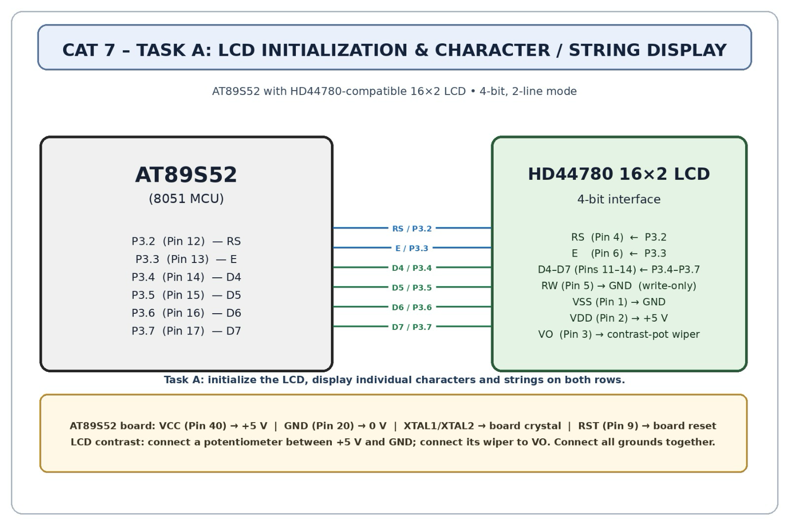

# CAT7 – Task 7A – LCD Initialization and Character/String Display

| Field | Details |
|---|---|
| **EXP** | CAT7 |
| **DATE** | 24/08/2026 |
| **NAME OF EXP** | 16x2 LCD Driver Development and Dynamic Display Control |
| **HARDWARE SETUP / PLATFORM** | AT89S52 (8051 core) development board, 11.0592 MHz crystal, Keil uVision C51, ISP programmer, 16x2 HD44780-compatible LCD (4-bit mode), 10 kΩ contrast potentiometer, 4x4 keypad |
| **TASK NO** | Task 7A – LCD Initialization and Character/String Display |

## 1. Objective

Develop a 4-bit GPIO-based LCD driver by deriving the required command sequence from the HD44780-compatible datasheet. Configure the LCD in 4-bit, 2-line mode; implement `lcd_init()`, `lcd_cmd()` and `lcd_data()`; display individual characters and strings on both rows (first test: display 'A' at the first position of the first row).

## 2. Circuit Diagram

**Pin Connections:**

| Signal / Component | MCU Pin | Description |
|---|---|---|
| VCC | +5 V | Board supply |
| GND | GND | Common ground |
| XTAL1 / XTAL2 | 11.0592 MHz crystal | System clock (1 machine cycle ≈ 1.085 µs) |
| LCD RS | P2.0 | Register select (0 = command, 1 = data) |
| LCD RW | GND | Write-only |
| LCD E | P2.1 | Enable (latch on falling edge) |
| LCD D4–D7 | P2.4 – P2.7 | 4-bit data bus |
| LCD VSS / VDD / V0 | GND / +5 V / 10 kΩ pot | Power and contrast |
| LCD A / K | +5 V (via resistor) / GND | Backlight |

## 3. Core Logic / Pseudocode / Code Base

**Working Principle:**

The HD44780 is a parallel interface. RS selects the instruction register (0) or data register (1), and data is latched on the falling edge of E. In 4-bit mode each byte is sent as two nibbles on D4–D7, which saves four I/O pins. Initialisation is a defined command sequence that sets interface mode, display configuration, cursor configuration and clears the display.

**Pseudocode:**

1. Wait > 15 ms after power-up.
2. Send the 4-bit wake-up nibbles 0x3, 0x3, 0x3, then 0x2 (switch to 4-bit).
3. Function Set `0x28` – 4-bit, 2-line, 5x8 font.
4. Display Control `0x0C` – display ON, cursor OFF, blink OFF.
5. Entry Mode `0x06` – cursor moves right, no display shift.
6. Clear Display `0x01` – clear DDRAM, cursor home.
7. `lcd_cmd(c)`: RS = 0, send high nibble + E pulse, low nibble + E pulse.
8. `lcd_data(d)`: same with RS = 1; display 'A', then strings on row 1 (0x80) and row 2 (0xC0).

**Code Base:**

`lcd_nibble()` writes a nibble to P2.4–P2.7 and pulses E; `lcd_cmd()` and `lcd_data()` call it twice with RS = 0 or 1; `lcd_init()` sends the sequence above.

**Initialisation Commands:**

| Command | Hex | Meaning |
|---|---|---|
| Function Set | 0x28 | 4-bit, 2-line, 5x8 font |
| Display Control | 0x0C | Display ON, cursor OFF, blink OFF |
| Entry Mode | 0x06 | Increment cursor, no shift |
| Clear Display | 0x01 | Clear DDRAM, return home |

## 4. Inference

**Observation:**

After initialisation, 'A' appeared at row 1, column 1, and strings were displayed correctly on both rows.

**Conclusion:**

The HD44780 can be fully controlled with six GPIO lines in 4-bit mode once the command sequence is derived from the datasheet.
