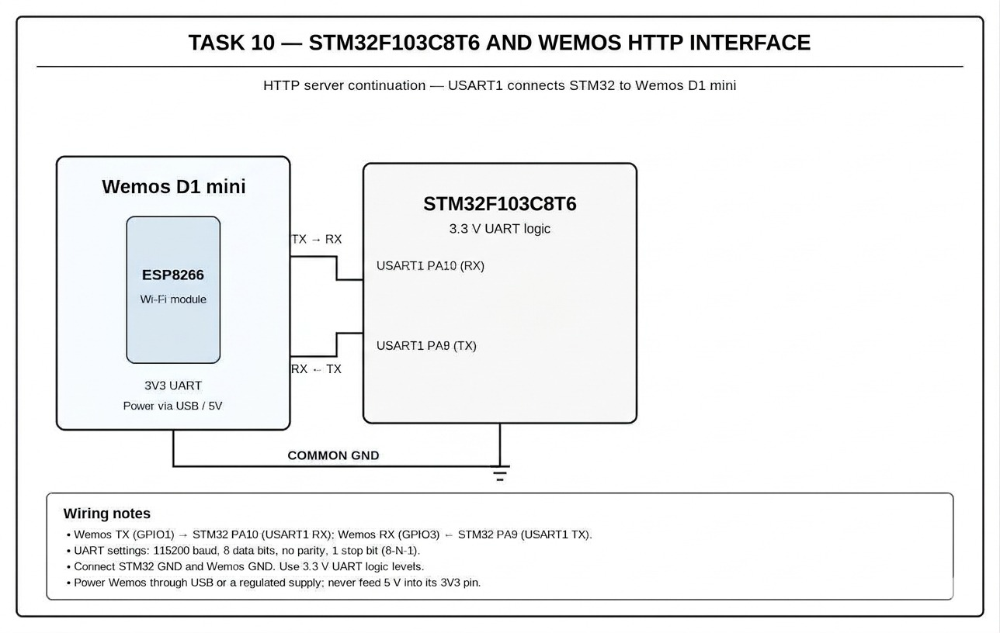

# CAT10 – Task A – Establish STM32 ↔ Wemos UART Communication (PDF: Task 9A)

| Field | Details |
|---|---|
| **EXP** | CAT10 |
| **DATE** | 05/10/2026 |
| **NAME OF EXP** | STM32–Wemos Wi-Fi Modem Interface Using AT Commands |
| **HARDWARE SETUP / PLATFORM** | STM32F103C8T6 Blue Pill (ARM Cortex-M3, 72 MHz), ST-Link V2, STM32CubeMX + Keil MDK-ARM (HAL), Wemos D1 Mini (ESP8266) Wi-Fi module, USB-to-TTL converter |
| **TASK NO** | Task A – Establish STM32 ↔ Wemos UART Communication (PDF: Task 9A) |

## 1. Objective

Before attempting Wi-Fi, prove that the two boards can communicate. Configure a UART connection between the STM32 and the Wemos, transmit the command `AT` followed by CR/LF from the STM32, and display the Wemos response on the PC terminal.

## 2. Circuit Diagram

**Pin Connections:**

| Signal / Component | MCU Pin | Description |
|---|---|---|
| 3.3 V / GND | 3V3 / GND | Board supply from ST-Link / USB |
| HSE | 8 MHz crystal → PLL 72 MHz | System clock (configured in CubeMX) |
| USART2 TX | PA2 | To Wemos RX |
| USART2 RX | PA3 | From Wemos TX |
| USART1 TX / RX | PA9 / PA10 | To USB-to-TTL converter (PC debug terminal) |
| Wemos 3.3 V / 5 V | 3V3 / 5V | Wemos power |
| Wemos GND | GND | Common ground |

## 3. Core Logic / Pseudocode / Code Base

**Working Principle:**

TX and RX are cross-connected (STM32 TX → Wemos RX, Wemos TX → STM32 RX) with a common ground. Both UARTs run at the ESP8266 AT firmware baud rate (115200, 8-N-1). The STM32 sends `AT\r\n`, receives the characters 'O', 'K', '\r', '\n' on its RX pin and forwards them to the PC UART.

**Pseudocode:**

1. Initialise HAL, USART2 (Wemos) and USART1 (PC) at 115200 baud.
2. Print "STM32-WiFi MODEM TEST" on the PC terminal.
3. Send "AT\r\n" on USART2 and print ">> AT" on the PC.
4. Receive the reply on USART2 with a timeout.
5. Print "<< " + reply on the PC terminal.

**Code Base:**

`HAL_UART_Transmit(&huart2, ...)` sends the command; `HAL_UART_Receive(&huart2, ..., timeout)` collects the reply; `HAL_UART_Transmit(&huart1, ...)` forwards it to the PC.

## 4. Inference

**Observation:**

The PC terminal showed ">> AT" followed by "<< OK", confirming the Wemos responded.

**Conclusion:**

UART communication between the STM32 and the ESP8266 works, so the STM32 can act as the host controller for the Wi-Fi modem.
