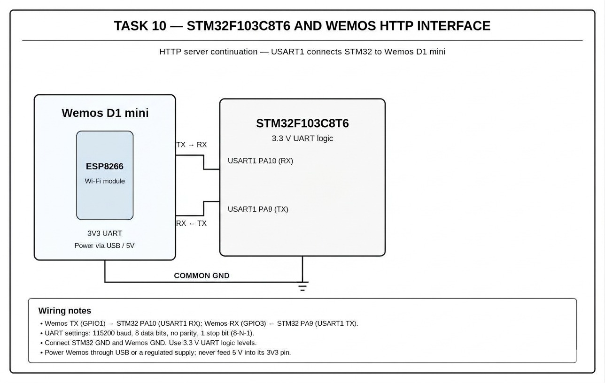

# CAT10 – Task B – Explore the ESP8266 AT Command Interface 

| Field | Details |
|---|---|
| **EXP** | CAT10 |
| **DATE** | 05/10/2026 |
| **NAME OF EXP** | STM32–Wemos Wi-Fi Modem Interface Using AT Commands |
| **HARDWARE SETUP / PLATFORM** | STM32F103C8T6 Blue Pill (ARM Cortex-M3, 72 MHz), ST-Link V2, STM32CubeMX + Keil MDK-ARM (HAL), Wemos D1 Mini (ESP8266) Wi-Fi module, USB-to-TTL converter |
| **TASK NO** | Task B – Explore the ESP8266 AT Command Interface (PDF: Task 9B) |

## 1. Objective

Explore the ESP8266 AT command interface using a command investigation table: determine which command checks the modem, firmware version, sets station mode, scans networks, connects to an AP, obtains network information, establishes a TCP connection and sends application data.

## 2. Circuit Diagram

**Pin Connections:**

| Signal / Component | MCU Pin | Description |
|---|---|---|
| 3.3 V / GND | 3V3 / GND | Board supply from ST-Link / USB |
| HSE | 8 MHz crystal → PLL 72 MHz | System clock (configured in CubeMX) |
| USART2 TX | PA2 | To Wemos RX |
| USART2 RX | PA3 | From Wemos TX |
| USART1 TX / RX | PA9 / PA10 | To USB-to-TTL converter (PC debug terminal) |
| Wemos 3.3 V / 5 V | 3V3 / 5V | Wemos power |
| Wemos GND | GND | Common ground |

## 3. Core Logic / Pseudocode / Code Base

**Working Principle:**

The ESP8266 AT firmware is controlled entirely by text commands terminated with \r\n. Each command returns a response followed by OK or ERROR. A helper function sends a command, collects the response for a fixed time and prints both on the PC terminal so each command can be studied.

**Pseudocode:**

1. Implement `send_at(cmd, timeout)` that transmits a command and prints the response.
2. Send each command from the investigation table in turn.
3. Record the response for each command.
4. Fill in the investigation table.

**Code Base:**

`send_at()` wraps `HAL_UART_Transmit()` / `HAL_UART_Receive()` on USART2 and echoes the exchange to USART1.

**AT Command Investigation Table:**

| Requirement | Command |
|---|---|
| Check modem response | `AT` |
| Check firmware/version | `AT+GMR` |
| Set Wi-Fi station mode | `AT+CWMODE=1` |
| Scan available networks | `AT+CWLAP` |
| Connect to an AP | `AT+CWJAP="SSID","password"` |
| Obtain network information | `AT+CIFSR` |
| Establish TCP connection | `AT+CIPSTART="TCP","<ip>",<port>` |
| Send application data | `AT+CIPSEND=<length>` |

## 4. Inference

**Observation:**

Each command returned the expected response: OK, firmware version details, the list of nearby networks, the assigned IP address, etc.

**Conclusion:**

The ESP8266 can be fully configured and controlled through text AT commands, so no Wi-Fi stack is needed on the STM32.
