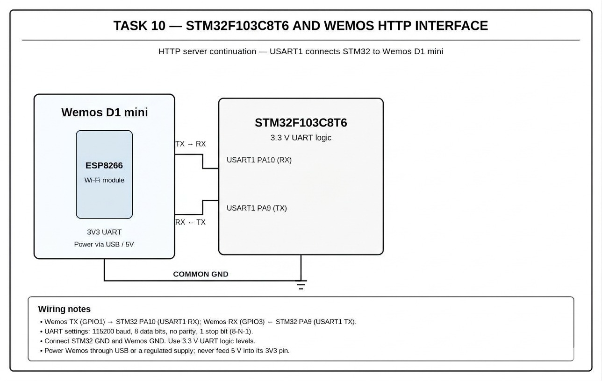

# CAT10 – Task C – Connect Wemos to Wi-Fi (PDF: Task 9C)

| Field | Details |
|---|---|
| **EXP** | CAT10 |
| **DATE** | 05/10/2026 |
| **NAME OF EXP** | STM32–Wemos Wi-Fi Modem Interface Using AT Commands |
| **HARDWARE SETUP / PLATFORM** | STM32F103C8T6 Blue Pill (ARM Cortex-M3, 72 MHz), ST-Link V2, STM32CubeMX + Keil MDK-ARM (HAL), Wemos D1 Mini (ESP8266) Wi-Fi module, USB-to-TTL converter |
| **TASK NO** | Task C – Connect Wemos to Wi-Fi (PDF: Task 9C) |

## 1. Objective

Develop STM32 firmware that configures the Wemos ESP8266 as a Wi-Fi station and connects it to the university/local Wi-Fi network using AT commands, then reports WIFI MODE, WIFI STATUS and IP ADDRESS on the PC terminal.

## 2. Circuit Diagram

**Pin Connections:**

| Signal / Component | MCU Pin | Description |
|---|---|---|
| 3.3 V / GND | 3V3 / GND | Board supply from ST-Link / USB |
| HSE | 8 MHz crystal → PLL 72 MHz | System clock (configured in CubeMX) |
| USART2 TX | PA2 | To Wemos RX |
| USART2 RX | PA3 | From Wemos TX |
| USART1 TX / RX | PA9 / PA10 | To USB-to-TTL converter (PC debug terminal) |
| Wemos 3.3 V / 5 V | 3V3 / 5V | Wemos power |
| Wemos GND | GND | Common ground |

## 3. Core Logic / Pseudocode / Code Base

**Working Principle:**

The connection is a sequence of AT commands, each of which must succeed before the next one is sent. The STM32 checks each response for the expected string ("OK", "WIFI CONNECTED", "WIFI GOT IP") and then queries the IP address.

**Pseudocode:**

1. Send `AT` → expect OK.
2. Send `AT+CWMODE=1` → expect OK (station mode).
3. Send `AT+CWJAP="SSID","password"` → wait for WIFI CONNECTED, WIFI GOT IP, OK.
4. Send `AT+CIFSR` → extract the station IP.
5. Print WIFI MODE : STATION, WIFI STATUS : CONNECTED, IP ADDRESS : xxx.xxx.xxx.xxx.

**Code Base:**

Sequential `send_at()` calls with `strstr()` checks on each response. Wi-Fi credentials are replaced with placeholders in the submitted code.

## 4. Inference

**Observation:**

The terminal showed WIFI CONNECTED and WIFI GOT IP, followed by WIFI MODE : STATION, WIFI STATUS : CONNECTED and the assigned IP address.

**Conclusion:**

The STM32 can bring the ESP8266 onto a Wi-Fi network using AT commands, preparing the node for TCP/HTTP and MQTT communication in later experiments.
