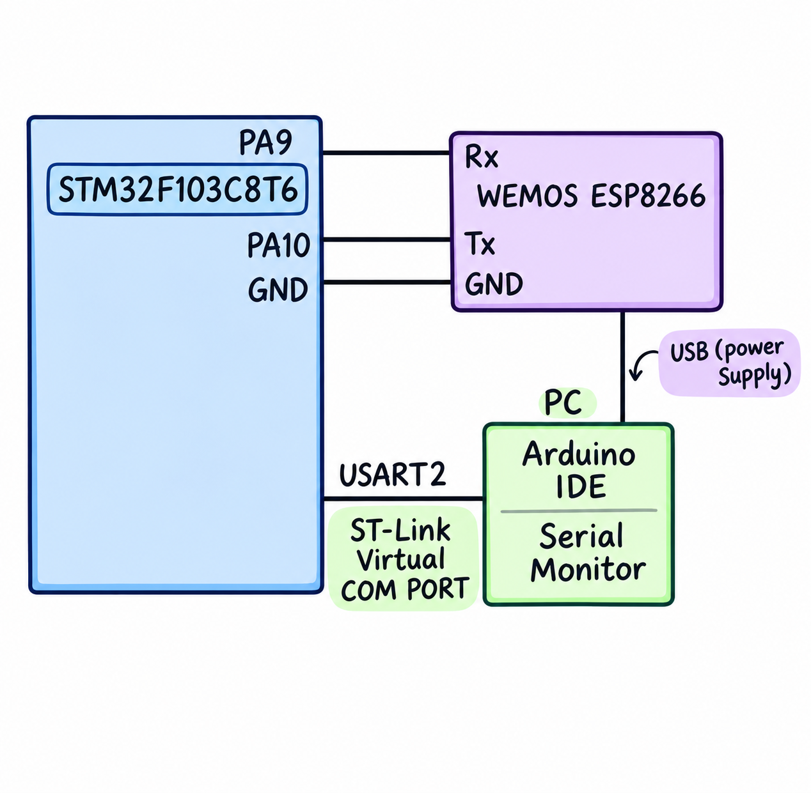

# CAT11 – STM32 Cortex M3 + ESP8266 HTTP Server

> **Note:** No separate questions PDF was issued for this week; it is a continuation of CAT10.

| Field | Details |
|---|---|
| **EXP** | CAT11 |
| **DATE** | 12/10/2026 |
| **NAME OF EXP** | STM32 Cortex M3 + ESP8266 HTTP Server |
| **HARDWARE SETUP / PLATFORM** | STM32F103C8T6 Blue Pill (ARM Cortex-M3, 72 MHz), ST-Link V2, STM32CubeMX + Keil MDK-ARM (HAL), Wemos D1 Mini (ESP8266) |
| **TASK NO** | Single task – HTTP Server using ESP8266 AT Commands (continuation of CAT10) |

## 1. Objective

As a continuation of CAT10, configure the ESP8266 as a TCP server on port 80 so that a browser on the same network can send an HTTP request to the module's IP address and receive a response generated by the STM32.

## 2. Circuit Diagram




**Pin Connections:**

| Signal / Component | MCU Pin | Description |
|---|---|---|
| 3.3 V / GND | 3V3 / GND | Board supply from ST-Link / USB |
| HSE | 8 MHz crystal → PLL 72 MHz | System clock (configured in CubeMX) |
| USART2 TX | PA2 | To Wemos RX |
| USART2 RX | PA3 | From Wemos TX |
| USART1 TX / RX | PA9 / PA10 | To USB-to-TTL converter (PC debug terminal) |
| Wemos 3.3 V / 5 V | 3V3 / 5V | Wemos power |
| Wemos GND | GND | Common ground |

## 3. Core Logic / Pseudocode / Code Base

**Working Principle:**

After joining Wi-Fi, the ESP8266 is set to multiple-connection mode and started as a server on port 80. A browser request arrives at the STM32 as `+IPD,<id>,<len>:GET / HTTP/1.1…`. The STM32 builds a raw HTTP response (status line, headers, blank line, body) with `Content-Length` equal to the actual body length, sends it with `AT+CIPSEND`, and closes the connection.

**Pseudocode:**

1. Connect to Wi-Fi as in CAT10 and read the IP with `AT+CIFSR`.
2. `AT+CIPMUX=1` – allow multiple connections.
3. `AT+CIPSERVER=1,80` – start the TCP server.
4. Wait for `+IPD,<id>` from the browser.
5. Build the body and compute `Content-Length = strlen(body)`.
6. Build the response: `HTTP/1.1 200 OK`, `Content-Type`, `Content-Length`, blank line, body.
7. `AT+CIPSEND=<id>,<length>` → wait for '>' → send the response.
8. `AT+CIPCLOSE=<id>` and wait for the next request.

**Code Base:**

```c
snprintf(http, sizeof(http),
  "HTTP/1.1 200 OK\r\nContent-Type: text/html\r\nContent-Length: %d\r\n\r\n%s",
  (int)strlen(body), body);
snprintf(cmd, sizeof(cmd), "AT+CIPSEND=%d,%d\r\n", link_id, (int)strlen(http));
```

## 4. Inference

**Observation:**

Opening `http://<module-IP>/` in a browser displayed the page sent by the STM32, and the request/response exchange was visible on the debug terminal.

**Conclusion:**

Using only AT commands, the STM32 + ESP8266 work as a simple web server. A correct `Content-Length` and the `\r\n` header terminators are essential for the browser to accept the response.
