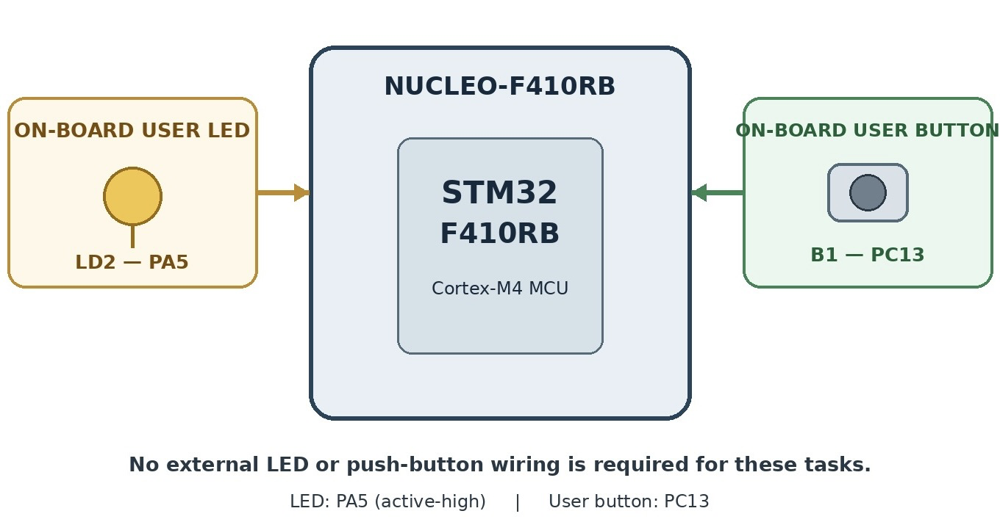

# CAT12 – Task 3 – Short-Press and Long-Press Detection

| Field | Details |
|---|---|
| **EXP** | CAT12 |
| **DATE** | 14/10/2026 |
| **NAME OF EXP** | STM32F401RE Cortex-M4: GPIO and User Input Programming |
| **HARDWARE SETUP / PLATFORM** | NUCLEO-F401RE (STM32F401RE, ARM Cortex-M4F, up to 84 MHz), on-board ST-Link, STM32CubeMX + Keil MDK-ARM (HAL), on-board LED LD2 and user button B1 |
| **TASK NO** | Task 3 – Short-Press and Long-Press Detection |

## 1. Objective

Extend the application to distinguish between a short button press and a long button press. The STM32 shall perform different actions depending on the duration of the button press.

## 2. Circuit Diagram

**Pin Connections:**

| Signal / Component | MCU Pin | Description |
|---|---|---|
| 3.3 V / GND | 3V3 / GND | Board supply from USB (ST-Link) |
| Clock | HSI 16 MHz / ST-Link MCO 8 MHz → PLL 84 MHz | System clock (configured in CubeMX) |
| LD2 (user LED) | PA5 | Output, active-HIGH |
| B1 (user button) | PC13 | Input, active-LOW (external pull-up on board) |

## 3. Core Logic / Pseudocode / Code Base

**Working Principle:**

The press duration is measured as release time − press time using `HAL_GetTick()`. A press shorter than 1 s is classified as short (toggle LD2); 1 s or longer is long (start/stop fast blinking). Blinking uses non-blocking tick comparisons.

**Pseudocode:**

1. On press: `start = HAL_GetTick()`.
2. On release: `duration = HAL_GetTick() − start`.
3. `duration < 1000` → short press: toggle LED (or stop blinking).
4. `duration ≥ 1000` → long press: enter blinking mode.
5. Blinking mode: toggle LD2 every 200 ms using tick comparison.
6. Repeat continuously.

**Code Base:**

`HAL_GetTick()` for press timing and blinking; no blocking delays in the button logic.

## 4. Inference

**Observation:**

Short presses toggled LD2 and long presses switched it into blinking mode; the classification was reliable around the 1 s threshold.

**Conclusion:**

Press duration measured with the HAL tick lets a single button provide multiple functions without blocking the application.
