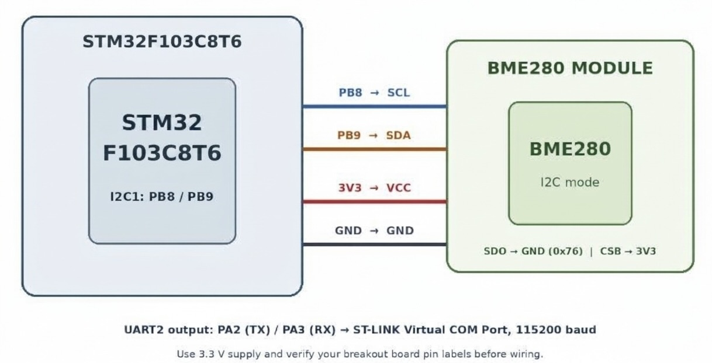

# CAT13 – BME280 Sensor Interfacing Using I²C and Bosch Sensor API

| Field | Details |
|---|---|
| **EXP** | CAT13 |
| **DATE** | 23/10/2026 |
| **NAME OF EXP** | BME280 Sensor Interfacing Using I²C and Bosch Sensor API |
| **HARDWARE SETUP / PLATFORM** | NUCLEO-F401RE (STM32F401RE, ARM Cortex-M4F, up to 84 MHz), on-board ST-Link, STM32CubeMX + Keil MDK-ARM (HAL), BME280 sensor (I²C), ESP8266 Wi-Fi module |
| **TASK NO** | Single task – Sensor Interfacing (BME280) – STM32 (Debug) – ESP8266 (Wi-Fi) HTTP |

## 1. Objective

Develop an STM32-based environmental sensing application to interface a BME280 sensor using the I²C protocol and obtain compensated temperature, pressure and humidity using the Bosch Sensortec BME280 Sensor API (`bme280.c`, `bme280.h`, `bme280_defs.h`). Display the values on the UART terminal, then construct a JSON payload and serve it as a raw HTTP response through the ESP8266.

## 2. Circuit Diagram




**Pin Connections:**

| Signal / Component | MCU Pin | Description |
|---|---|---|
| 3.3 V / GND | 3V3 / GND | Board supply from USB (ST-Link) |
| Clock | HSI 16 MHz / ST-Link MCO 8 MHz → PLL 84 MHz | System clock (configured in CubeMX) |
| BME280 SCL | PB8 (I2C1_SCL) | I²C clock |
| BME280 SDA | PB9 (I2C1_SDA) | I²C data |
| BME280 VCC / GND | 3V3 / GND | Sensor power |
| BME280 SDO | GND | I²C address 0x76 |
| BME280 CSB | 3V3 | Selects I²C mode |
| USART2 TX / RX | PA2 / PA3 | ST-Link virtual COM port (PC terminal) |
| ESP8266 TX / RX | PA10 / PA9 (USART1) | Wi-Fi module UART |
| ESP8266 VCC / GND | 3V3 / GND | Wi-Fi module power |

## 3. Core Logic / Pseudocode / Code Base

**Working Principle:**

The Bosch API is platform-independent; it needs three STM32-specific functions: `user_i2c_read()`, `user_i2c_write()` (using `HAL_I2C_Mem_Read/Write` at address 0x76 << 1) and `user_delay_us()`. `bme280_init()` checks the chip ID (register 0xD0 = 0x60) and loads the trim (calibration) data. After configuring oversampling and filter and setting normal mode, `bme280_get_sensor_data()` reads the raw registers and applies Bosch's compensation formulas.

**Pseudocode:**

1. Initialise HAL, clock, GPIO, I2C1 and UARTs.
2. Set `dev.intf_ptr = &dev_addr (0x76)`, `dev.intf = BME280_I2C_INTF`, `dev.read/write/delay_us`.
3. `bme280_init(&dev)` → read chip ID; if not 0x60, report an error and halt.
4. Set `osr_t`, `osr_p`, `osr_h` (1X) and filter OFF with `bme280_set_sensor_settings()`.
5. `bme280_set_sensor_mode(BME280_MODE_NORMAL, &dev)`.
6. Loop every 1 s: `bme280_get_sensor_data(BME280_ALL, &comp_data, &dev)`.
7. Convert pressure Pa → hPa and print Temperature, Pressure, Humidity on UART.
8. Build JSON with `snprintf()`, compute `Content-Length = strlen(json)`, build the HTTP response and send via `AT+CIPSEND`.

**Code Base:**

```c
snprintf(json, sizeof(json),
  "{\"status\":\"success\",\"temperature\":%.2f,\"humidity\":%.2f,\"pressure\":%.2f}",
  temperature, humidity, pressure);
int content_length = strlen(json);
snprintf(http_response, sizeof(http_response),
  "HTTP/1.1 200 OK\r\nContent-Type: application/json\r\nContent-Length: %d\r\n\r\n%s",
  content_length, json);
```

**Required Output (UART):**

```
Temperature : XX.XX °C
Pressure    : XXXX.XX hPa
Humidity    : XX.XX %RH
```

**Demonstration Checklist:**

1. I²C communication established between STM32 and BME280.
2. Correct BME280 chip ID (0x60) read from the sensor.
3. Bosch API initialised and sensor configuration written successfully.
4. Raw measurement registers read successfully.
5. Bosch compensation produces valid temperature, pressure and humidity.
6. Values transmitted through UART.
7. Values change appropriately when the sensor environment changes.

## 4. Inference

**Observation:**

The chip ID 0x60 was read correctly and the terminal printed realistic room values for temperature, pressure and humidity once per second. Warming the sensor by hand raised the temperature and humidity readings. Changing oversampling/filter settings made the readings smoother. The browser received the JSON response with the live values.

**Conclusion:**

Using the vendor's sensor API with small platform-specific I²C wrappers gives accurate compensated readings without rewriting the compensation equations. Combining it with the ESP8266 completes a sensor → STM32 → Wi-Fi → HTTP data path.
