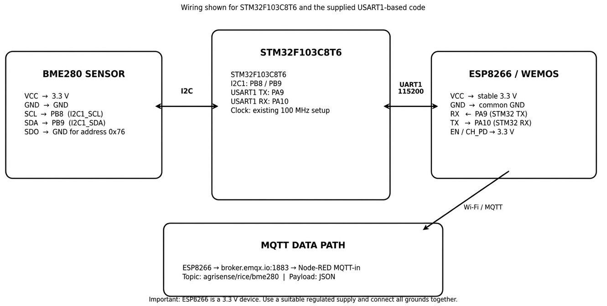

# CAT14 - BME280 Sensor Interfacing Using I2C and (MQTT) using Custom Built ESP8266 API

| Field | Details |
|---|---|
| **EXP** | CAT14 |
| **DATE** | 27/10/2026 |
| **NAME OF EXP** | BME280 Sensor Interfacing Using I2C and (MQTT) using Custom Built ESP8266 API |
| **HARDWARE SETUP / PLATFORM** | NUCLEO-F401RE (STM32F401RE, ARM Cortex-M4), on-board ST-Link, STM32CubeMX + Keil MDK, BME280 sensor (I2C), ESP8266 Wi-Fi module, MQTT broker, Node-RED |
| **TASK NO** | Single task (no subdivisions in the questions PDF) |

## Circuit Diagram

## Core Logic / Pseudocode / Code Base

<!-- Explain the implementation -->

## INFERENCE

<!-- Observation and conclusion -->
