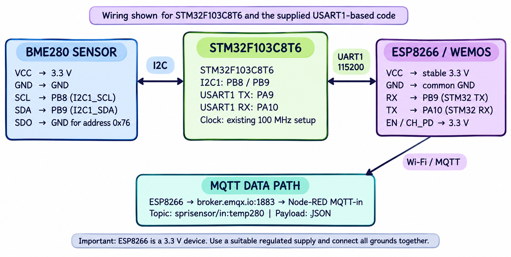
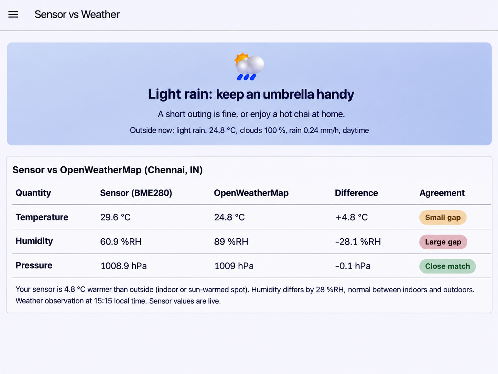

# CAT15 – Complete IoT Flow: BME280 Sensor vs OpenWeatherMap (Chennai) using MQTT and Node-RED Dashboard

| Field | Details |
|---|---|
| **EXP** | CAT15 |
| **DATE** | 02/11/2026 |
| **NAME OF EXP** | Project Submission – Complete IoT Flow |
| **HARDWARE SETUP / PLATFORM** | NUCLEO-F401RE (STM32F401RE, ARM Cortex-M4F, up to 84 MHz), on-board ST-Link, STM32CubeMX + Keil MDK-ARM (HAL), BME280 sensor (I²C), ESP8266 Wi-Fi module, MQTT broker (broker.emqx.io), Node-RED + Node-RED Dashboard, OpenWeatherMap Current Weather API |
| **TASK NO** | Single task – Sensor (BME280) → STM32 → ESP8266 → MQTT → Node-RED Dashboard with OpenWeatherMap comparison |

## 1. Objective

Extend the CAT14 sensing node into a complete end-to-end IoT application. The STM32 reads compensated temperature, humidity and pressure from the BME280 over I²C and publishes them as JSON over MQTT using the custom ESP8266 library. Node-RED subscribes to this data, fetches the current outdoor weather for **Chennai, IN** from the **OpenWeatherMap API** (using an API key), compares the indoor sensor readings with the outdoor values, and presents the result on a live **"Sensor vs Weather" dashboard** that shows:

- a weather verdict card (condition, advice and current outdoor conditions), and
- a comparison table with the sensor value, OpenWeatherMap value, difference and an agreement label for each quantity.

## 2. Circuit Diagram & Dashboard






**Pin Connections:**

| Signal / Component | MCU Pin | Description |
|---|---|---|
| 3.3 V / GND | 3V3 / GND | Board supply from USB (ST-Link) |
| Clock | HSI 16 MHz / ST-Link MCO 8 MHz → PLL 84 MHz | System clock (configured in CubeMX) |
| BME280 SCL | PB8 (I2C1_SCL) | I²C clock |
| BME280 SDA | PB9 (I2C1_SDA) | I²C data |
| BME280 VCC / GND | 3V3 / GND | Sensor power |
| BME280 SDO | GND | I²C address 0x76 |
| BME280 CSB | 3V3 | Selects I²C mode |
| USART2 TX / RX | PA2 / PA3 | ST-Link virtual COM port (PC terminal) |
| ESP8266 TX / RX | PA10 / PA9 (USART1) | Wi-Fi module UART |
| ESP8266 VCC / GND | 3V3 / GND | Wi-Fi module power |

**System Data Flow:**

```
BME280 ──I²C──► STM32F401RE ──UART/AT──► ESP8266 ──Wi-Fi/MQTT──► Broker (broker.emqx.io:1883)
                                                                        │
                                                                        ▼
OpenWeatherMap API (Chennai, IN) ──HTTP/JSON──► Node-RED ◄── MQTT-in ───┘
                                                   │
                                                   ▼
                                     Dashboard: "Sensor vs Weather"
```

## 3. Core Logic / Pseudocode / Code Base

**Working Principle:**

The embedded side is the same as CAT14: the Bosch BME280 API reads and compensates the sensor data, and the custom ESPLib connects the ESP8266 to Wi-Fi and the MQTT broker and publishes a JSON message every second. `MQTTTimer()` is called from `SysTick_Handler()` to maintain the MQTT keep-alive.

On the Node-RED side, the MQTT-in node receives the sensor JSON and stores the latest reading. An HTTP request node periodically calls the OpenWeatherMap Current Weather API for Chennai in metric units and receives temperature, humidity, pressure, cloud cover, rain and the weather description. A function node calculates the difference between the indoor sensor and outdoor weather for each quantity, assigns an agreement label based on the size of the difference, builds a short verdict and advice message from the weather condition, and sends the result to the dashboard.

**Pseudocode:**

*STM32 (embedded):*

1. Initialise HAL, clock, I2C1, the UARTs and the BME280 (chip ID, settings, normal mode).
2. `ESP8266_Init()`, `ESP8266_wifiConnect(SSID, password)`.
3. `ESP8266_portConnect("TCP", "broker.emqx.io", "1883")` and `MQTT_connectBroker()`.
4. Loop every 1 s: `bme280_get_sensor_data()` → convert pressure Pa → hPa.
5. Build the JSON `{"status":"success","temperature":..,"humidity":..,"pressure":..}`.
6. `MQTT_publishTopic(topic, json, QoS0)`.

*Node-RED (application):*

1. **MQTT-in** (same topic) → **JSON** node → store `{temperature, humidity, pressure}` in flow context.
2. **Inject** node (periodic) → **HTTP request** to `https://api.openweathermap.org/data/2.5/weather?q=Chennai,IN&units=metric&appid=<API_KEY>` → **JSON**.
3. **Function** node: read the latest sensor values and the weather response (`main.temp`, `main.humidity`, `main.pressure`, `clouds.all`, `rain["1h"]`, `weather[0].description`, day/night).
4. For each quantity compute `difference = sensor − OpenWeatherMap`.
5. Classify `|difference|` as **Close match**, **Small gap** or **Large gap** using per-quantity thresholds.
6. Choose a verdict and advice from the weather condition (for example rain → "keep an umbrella handy").
7. Generate a summary sentence (for example "Your sensor is 4.8 °C warmer than outside").
8. **Dashboard** nodes: show the verdict card and the comparison table; refresh on every new sensor message or weather update.

**Code Base:**

- **STM32:** `Core/Src/main.c` (BME280 + MQTT publish), `bme280.c/.h`, `bme280_defs.h`, `ESPLib.c/.h`, CubeMX `.ioc` and Keil `.uvprojx`, same as CAT14.
- **Node-RED:** MQTT-in, JSON, inject, HTTP request, function and dashboard nodes. The OpenWeatherMap API key and the Wi-Fi credentials are replaced with placeholders in the submitted files.

**Agreement Classification:**

| Quantity | Close match | Small gap | Large gap |
|---|---|---|---|
| Temperature | ≤ 2 °C | 2 – 5 °C | > 5 °C |
| Humidity | ≤ 5 %RH | 5 – 15 %RH | > 15 %RH |
| Pressure | ≤ 2 hPa | 2 – 5 hPa | > 5 hPa |

## 4. Inference

**Observation:**

The dashboard updated live from the STM32's MQTT messages and showed the current outdoor weather for Chennai (light rain, 24.8 °C, 100 % clouds, rain 0.24 mm/h, daytime) with the verdict "Light rain: keep an umbrella handy". The comparison at 15:15 local time was:

| Quantity | Sensor (BME280) | OpenWeatherMap | Difference | Agreement |
|---|---|---|---|---|
| Temperature | 29.6 °C | 24.8 °C | +4.8 °C | Small gap |
| Humidity | 60.9 %RH | 89 %RH | −28.1 %RH | Large gap |
| Pressure | 1008.9 hPa | 1009 hPa | −0.1 hPa | Close match |

**Conclusion:**

Pressure matched almost exactly, which confirms that the sensor and its Bosch compensation are accurate, since atmospheric pressure is the same indoors and outdoors. The indoor temperature was 4.8 °C higher and the humidity 28 %RH lower than outside, which is expected because the sensor was in a closed room while it was raining outside. This experiment completes the full IoT flow: sensing (BME280) → processing (STM32) → connectivity (ESP8266 + MQTT) → cloud data integration (OpenWeatherMap API) → analytics and visualisation (Node-RED dashboard).
