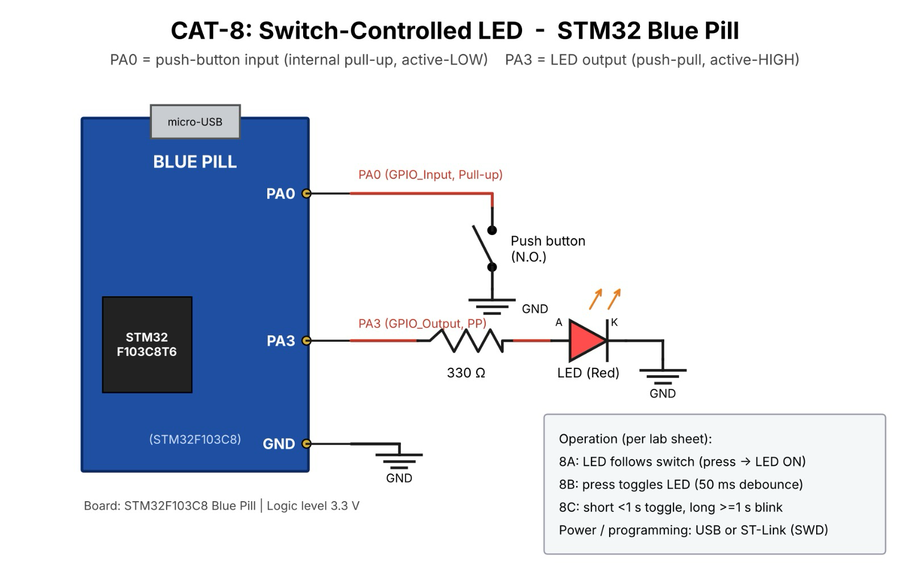

# CAT8 – Task 8A – GPIO Input/Output

| Field | Details |
|---|---|
| **EXP** | CAT8 |
| **DATE** | 18/09/2026 |
| **NAME OF EXP** | STM32 GPIO Bring-Up and Switch-Controlled LED |
| **HARDWARE SETUP / PLATFORM** | STM32F103C8T6 Blue Pill (ARM Cortex-M3, 72 MHz), ST-Link V2, STM32CubeMX + Keil MDK-ARM (HAL), LED, push-button |
| **TASK NO** | Task 8A – GPIO Input/Output |

## 1. Objective

Interface a push-button and LED with the STM32. Configure the corresponding GPIO pins and develop firmware so that the LED follows the switch state.

## 2. Circuit Diagram

**Pin Connections:**

| Signal / Component | MCU Pin | Description |
|---|---|---|
| 3.3 V / GND | 3V3 / GND | Board supply from ST-Link / USB |
| HSE | 8 MHz crystal → PLL 72 MHz | System clock (configured in CubeMX) |
| LED | PC13 | Output (on-board LED, active-LOW) |
| Push-button | PA0 | Input, internal pull-up; other side to GND |

## 3. Core Logic / Pseudocode / Code Base

**Working Principle:**

In CubeMX, PC13 is configured as GPIO_Output and PA0 as GPIO_Input with pull-up. The button reads HIGH when released and LOW when pressed. The firmware continuously reads the input and writes the matching state to the LED.

**Pseudocode:**

1. Initialise HAL, system clock and GPIO (`HAL_Init()`, `SystemClock_Config()`, `MX_GPIO_Init()`).
2. Read the button with `HAL_GPIO_ReadPin(GPIOA, GPIO_PIN_0)`.
3. If pressed (LOW), turn the LED ON; otherwise turn it OFF.
4. Repeat continuously.

**Code Base:**

`HAL_GPIO_ReadPin()` reads the switch and `HAL_GPIO_WritePin()` drives PC13 (active-LOW: `GPIO_PIN_RESET` = ON) inside `while(1)`.

## 4. Inference

**Observation:**

The LED was ON while the button was held and OFF as soon as it was released.

**Conclusion:**

HAL GPIO functions provide simple input reading and output control; the LED state directly follows the switch level.
