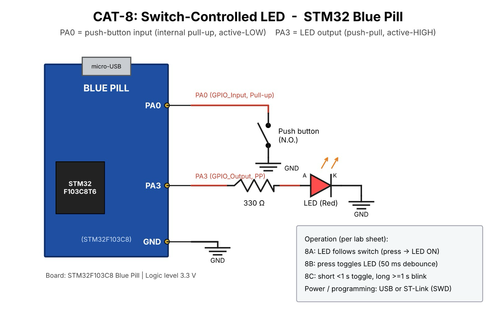

# CAT8 – Task 8C – Short Press vs Long Press

| Field | Details |
|---|---|
| **EXP** | CAT8 |
| **DATE** | 18/09/2026 |
| **NAME OF EXP** | STM32 GPIO Bring-Up and Switch-Controlled LED |
| **HARDWARE SETUP / PLATFORM** | STM32F103C8T6 Blue Pill (ARM Cortex-M3, 72 MHz), ST-Link V2, STM32CubeMX + Keil MDK-ARM (HAL), LED, push-button |
| **TASK NO** | Task 8C – Short Press vs Long Press |

## 1. Objective

Classify each button press by how long it is held: short press (< 1 s) toggles the LED, long press (≥ 1 s) puts the LED in continuous blinking mode; the next short press stops blinking and another long press returns to blinking. The application must not use a blocking delay to detect a long press.

## 2. Circuit Diagram

**Pin Connections:**

| Signal / Component | MCU Pin | Description |
|---|---|---|
| 3.3 V / GND | 3V3 / GND | Board supply from ST-Link / USB |
| HSE | 8 MHz crystal → PLL 72 MHz | System clock (configured in CubeMX) |
| LED | PC13 | Output (on-board LED, active-LOW) |
| Push-button | PA0 | Input, internal pull-up; other side to GND |

## 3. Core Logic / Pseudocode / Code Base

**Working Principle:**

Press duration is measured with the HAL millisecond tick: record the start time on press, record the release time on release, and classify `duration = release − start`. Blinking also uses `HAL_GetTick()` comparisons, so the program keeps running while the button is held.

**Pseudocode:**

1. On press: `start = HAL_GetTick()` and continue running.
2. On release: `duration = HAL_GetTick() − start`.
3. If `duration < 1000`: if blinking → stop blinking, else toggle LED.
4. If `duration ≥ 1000`: enter blinking mode.
5. Blinking mode: if `HAL_GetTick() − last ≥ 250`, toggle LED and set `last`.
6. Repeat continuously.

**Code Base:**

Uses `HAL_GPIO_ReadPin()`, `HAL_GPIO_WritePin()`, `HAL_GPIO_TogglePin()` and `HAL_GetTick()`; `HAL_Delay()` is not used for press detection.

| User Action | System Response |
|---|---|
| Short press | Toggle LED |
| Long press | LED enters continuous blinking mode |
| Next short press | Stop blinking |
| Long press again | Return to blinking mode |

## 4. Inference

**Observation:**

Short presses toggled the LED, long presses started blinking, and a short press during blinking stopped it. The button responded immediately in all states.

**Conclusion:**

Non-blocking timing with `HAL_GetTick()` lets the firmware measure press duration and run the blinking pattern at the same time.
