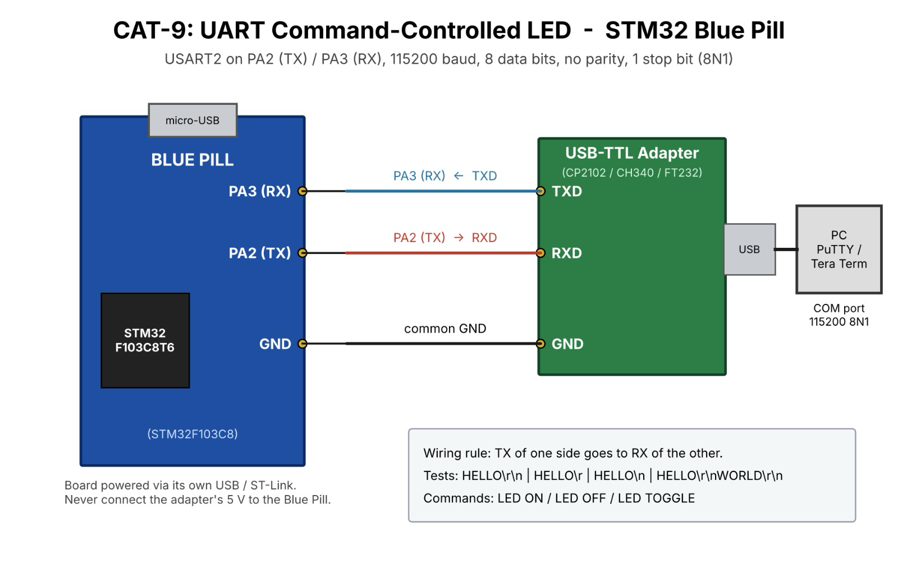

# CAT9 – Task 9A – Basic UART Communication

| Field | Details |
|---|---|
| **EXP** | CAT9 |
| **DATE** | 28/09/2026 |
| **NAME OF EXP** | STM32 UART Command Controlled LED |
| **HARDWARE SETUP / PLATFORM** | STM32F103C8T6 Blue Pill (ARM Cortex-M3, 72 MHz), ST-Link V2, STM32CubeMX + Keil MDK-ARM (HAL), USB-to-TTL serial converter, PC with PuTTY |
| **TASK NO** | Task 9A – Basic UART Communication |

## 1. Objective

Configure UART using STM32CubeMX and HAL, establish communication between the STM32 and a PC terminal, and implement character and string transmission/reception: (1) transmit a character repeatedly, (2) echo every character received from the PC. Investigate the behaviour of \r and \n using the test strings "HELLO\r\n", "HELLO\r", "HELLO\n" and "HELLO\r\nWORLD\r\n".

## 2. Circuit Diagram

**Pin Connections:**

| Signal / Component | MCU Pin | Description |
|---|---|---|
| 3.3 V / GND | 3V3 / GND | Board supply from ST-Link / USB |
| HSE | 8 MHz crystal → PLL 72 MHz | System clock (configured in CubeMX) |
| USART1 TX | PA9 | To RX of USB-to-TTL converter |
| USART1 RX | PA10 | From TX of USB-to-TTL converter |
| GND | GND | Common ground with converter |
| LED | PC13 | On-board LED, active-LOW |

## 3. Core Logic / Pseudocode / Code Base

**Working Principle:**

USART1 is configured in asynchronous mode at 9600 baud, 8 data bits, no parity, 1 stop bit. `HAL_UART_Transmit()` sends bytes in polling mode and `HAL_UART_Receive()` waits for incoming bytes. On the terminal, CR moves the cursor to the start of the line and LF moves it down one line.

**Pseudocode:**

1. Initialise HAL, clock, GPIO and USART1 (`MX_USART1_UART_Init()`).
2. Transmit a fixed character repeatedly with a 500 ms delay.
3. Modify: receive one byte with `HAL_UART_Receive(&huart1, &ch, 1, HAL_MAX_DELAY)`.
4. Transmit the same byte back.
5. Send each CR/LF test string and record the PuTTY output.

**Code Base:**

Only `HAL_UART_Init()`, `HAL_UART_Transmit()` and `HAL_UART_Receive()` are used (polling mode).

| Test String | PuTTY Result |
|---|---|
| "HELLO\r\n" | HELLO then cursor at start of next line |
| "HELLO\r" | Cursor returns to start of same line; next text overwrites HELLO |
| "HELLO\n" | Next line, but cursor stays at the same column (staircase effect) |
| "HELLO\r\nWORLD\r\n" | HELLO and WORLD on separate lines |

## 4. Inference

**Observation:**

The character was received repeatedly in PuTTY, and every typed character was echoed back. The CR/LF tests behaved as shown in the table.

**Conclusion:**

Both CR and LF are needed: CR returns the cursor to column 0 and LF advances to the next line, so `\r\n` produces a proper new line on a terminal.
