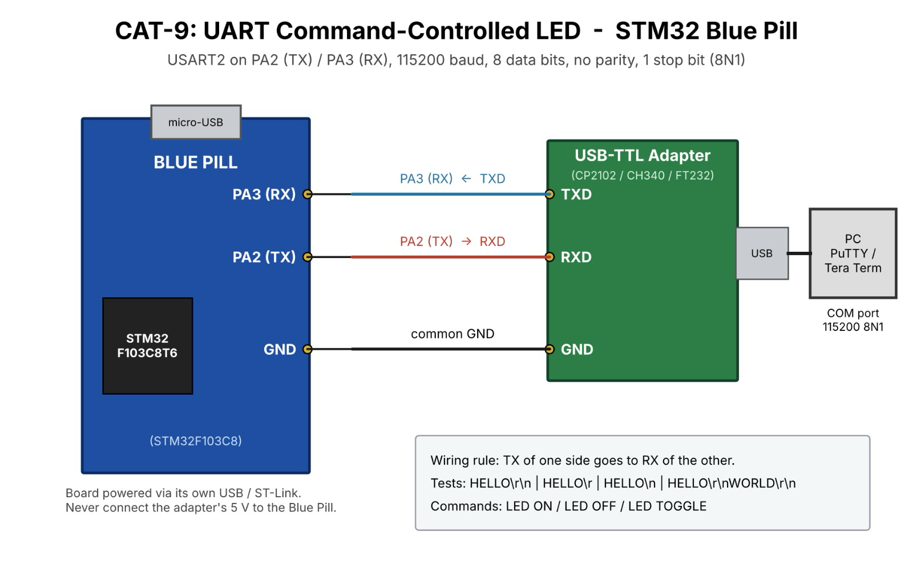

# CAT9 – Task 9B – String-Based Application Logic

| Field | Details |
|---|---|
| **EXP** | CAT9 |
| **DATE** | 28/09/2026 |
| **NAME OF EXP** | STM32 UART Command Controlled LED |
| **HARDWARE SETUP / PLATFORM** | STM32F103C8T6 Blue Pill (ARM Cortex-M3, 72 MHz), ST-Link V2, STM32CubeMX + Keil MDK-ARM (HAL), USB-to-TTL serial converter, PC with PuTTY |
| **TASK NO** | Task 9B – String-Based Application Logic |

## 1. Objective

Develop a UART-based command interface for the STM32. The system accepts commands from a terminal and controls the on-board LED, replying with a confirmation message ("> LED ON" → "LED turned ON", "> LED OFF" → "LED turned OFF", "> LED TOGGLE" → "LED toggled").

## 2. Circuit Diagram

**Pin Connections:**

| Signal / Component | MCU Pin | Description |
|---|---|---|
| 3.3 V / GND | 3V3 / GND | Board supply from ST-Link / USB |
| HSE | 8 MHz crystal → PLL 72 MHz | System clock (configured in CubeMX) |
| USART1 TX | PA9 | To RX of USB-to-TTL converter |
| USART1 RX | PA10 | From TX of USB-to-TTL converter |
| GND | GND | Common ground with converter |
| LED | PC13 | On-board LED, active-LOW |

## 3. Core Logic / Pseudocode / Code Base

**Working Principle:**

Received characters are stored in a command buffer until Enter (\r or \n) is received. The buffer is then terminated with '\0' and compared against the known commands using `strcmp()`. The matching action is performed on the LED and a response string is sent back.

**Pseudocode:**

1. Print a prompt "> ".
2. Receive characters one by one and echo them; store them in `cmd[]`.
3. On \r or \n: terminate the string.
4. "LED ON" → LED ON, reply "LED turned ON".
5. "LED OFF" → LED OFF, reply "LED turned OFF".
6. "LED TOGGLE" → toggle LED, reply "LED toggled".
7. Otherwise reply "Unknown command"; clear the buffer and repeat.

**Code Base:**

`HAL_UART_Receive()` for input, `strcmp()` for parsing, `HAL_GPIO_WritePin()` / `HAL_GPIO_TogglePin()` for the LED, `HAL_UART_Transmit()` for replies.

## 4. Inference

**Observation:**

Typing LED ON, LED OFF and LED TOGGLE controlled the LED correctly, each with its confirmation message; invalid input returned "Unknown command".

**Conclusion:**

A simple text protocol over UART lets a PC control the device, which is the basis of command-line and AT-command style interfaces.
